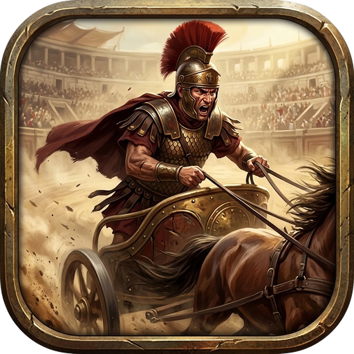

  

<h1 align="center">RR Turbo</h1>

<b>A faster, smoother Total War: ROME REMASTERED.</b> 
Shorter AI turns, quicker loading, and fixes for crashes and freezes.

  

Click the button above. One file, about 37 MB. It updates itself, so you only download it once.

---

## What it does

- **Faster end turns** - the computer players take their turns much quicker.
- **Faster loading** - campaigns and saves load sooner.
- **Fewer crashes and freezes** - fixes for many known crashes and hangs in the game.
- **A smarter campaign AI** - computer factions plan their wars and armies better.
- **Better interface** - lots of small improvements to the map and menus.
- **Better graphics on modern cards** - optional DLSS (NVIDIA) or FSR (AMD) upscaling.

Your game, your saves and your mods are never changed. Start the game the normal way and it is the plain game again.

## How to install

1. **Download** `RRTurbo.exe` with the button above.
2. **Put it in its own folder**, for example `C:\Games\RRTurbo`.
3. **Double-click it** and press **PLAY**. That's it - the game starts through Steam with Turbo on.

Tip: right-click `RRTurbo.exe` > *Show more options* > *Send to* > *Desktop (create shortcut)* to start it from your desktop.

## Windows Security says it's a virus?

RR Turbo works by hooking into the running game, which some virus scanners don't like. It is a false alarm.
If Windows blocks it or removes it:

1. Open **Windows Security** > **Virus & threat protection** > **Manage settings**.
2. Scroll to **Exclusions** > **Add or remove exclusions** > **Add an exclusion** > **Folder**.
3. Pick the folder with `RRTurbo.exe`. Add `%LOCALAPPDATA%\RRTurbo` the same way.
4. If the file was already removed: **Protection history** > the item > **Actions** > **Restore**.

## Good to know

- **Updates are automatic** - Turbo tells you when a new version is out.
- **Settings** - the *Modder settings* button in the Turbo window lets you switch any feature on or off. Most players never need it.
- **Single player only** - don't use it in multiplayer battles.
- **Uninstall** - open RR Turbo and click *Uninstall*. Nothing of your game is touched.
- **For the smoothest play**, untick *"Pause game on suspend"* once in the game's start window.

---

Not made by or affiliated with Feral Interactive, SEGA or Creative Assembly. 
This page holds the downloads only.

